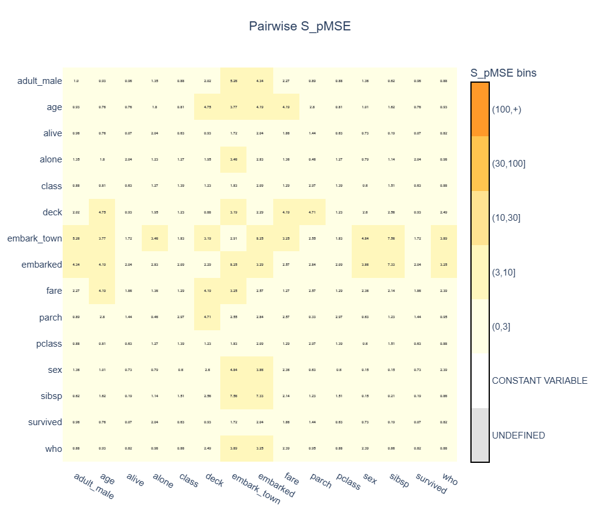
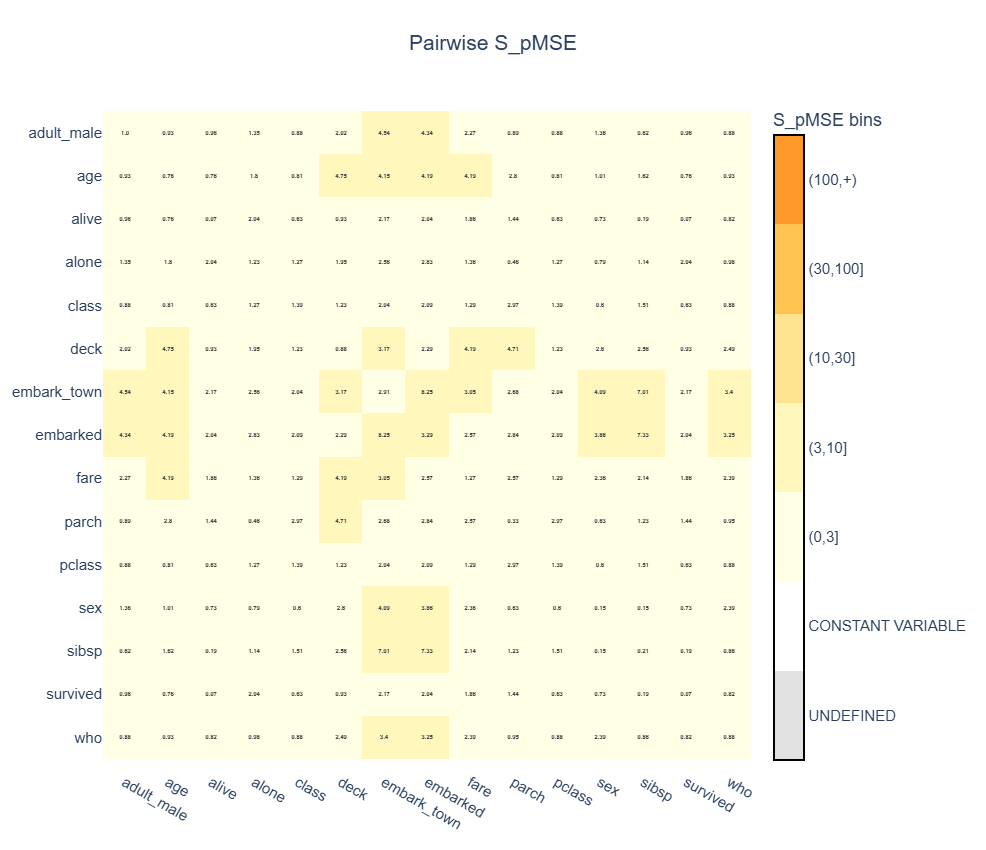
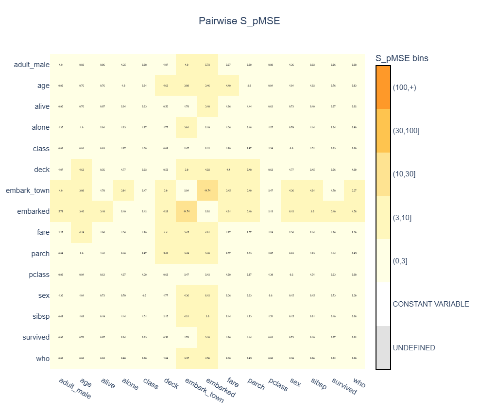
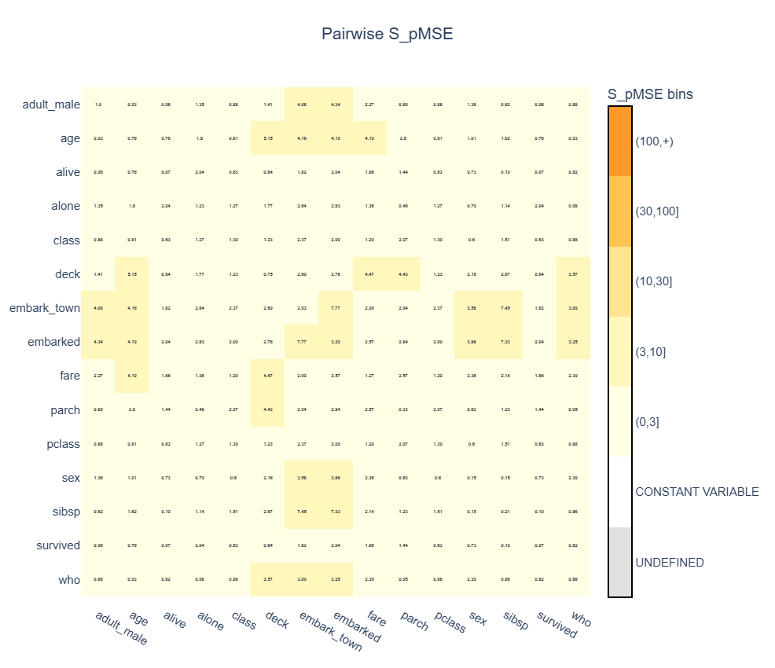

# Change the synthesis order

In the previous example, we generated a synthetic version of the Titanic dataset containing 5000 observations.

When evaluating the synthetic data using the S_pMSE heatmap, you may have noticed that some relationships between variables were better preserved than others.


The S_pMSE heatmap shows us that most relationships are reproduced well. Pairwise relationships involving `embark_town` or `embarked` show slightly larger S_pMSE values, meaning that those relationships were less well preserved in the synthetic data compared to others.

This does not necessarily mean that the synthesiser performed poorly. Instead, it suggests that the default synthesis settings might not be optimal for this dataset.

One of the most effective ways to improve the preservation of relationships is to change the **synthesis order**.

Because synthpop-py generates one variable at a time, each variable is modelled using the variables that have already been synthesised. Choosing a more appropriate synthesis order can therefore improve the quality of the generated synthetic data.

In this example, we will change the synthesis order and compare the resulting S_pMSE values with those from the previous example.

## The default synthesis order

By default, variables are synthesised in the same order as they appear in the DataFrame.

```python
data.columns
```

```text
Index([
    'survived',
    'pclass',
    'sex',
    'age',
    'sibsp',
    'parch',
    'fare',
    'embarked',
    'class',
    'who',
    'adult_male',
    'deck',
    'embark_town',
    'alive',
    'alone',
    ], dtype='str')
```

If the synthesiser is created with the default parameters, no `column_order` is specified and the original column order is used.

```python
from synthpop import Synthesiser

synthesiser = Synthesiser(random_seed=1)
```

## Why does the synthesis order matter?

synthpop-py generates variables **sequentially**.

The first variable is synthesised without predictors. In the default synthesis method, the first variable is sampled. The second variable is synthesised using the first synthetic variable as a predictor. The third variable uses the first two synthetic variables, and so on.

For example, with the default order,

```{mermaid}
---
zoom:
---
flowchart TB
    A["survived"]
    B["pclass"]
    C["sex"]
    D["age"]
    E["sibsp"]
    F["parch"]
    G["fare"]
    H["embarked"]
    I["class"]
    J["who"]
    K["adult_male"]
    L["deck"]
    M["embark_town"]
    N["alive"]
    O["alone"]

    A-->B-->C-->D-->E-->F-->G-->H-->I-->J-->K-->L-->M-->N-->O
```

the model for `alone` can use all fourteen measurements as predictors. However, the model for `alive` cannot use `alone`, because `alone` has not yet been synthesised. Every variable can only use the variables before it in the synthesis order as predictors. Variables generated later therefore have access to more information than variables generated earlier.

A good synthesis order often allows variables that are difficult to synthesise to use as many informative predictors as possible. One way to identify such variables is to inspect the S_pMSE heatmap. Variables that consistently appear in pairwise relationships with large S_pMSE values may benefit from being moved later in the synthesis order.

There is no synthesis order that is optimal for all datasets. The best order depends on the structure of the dataset and the relationships between variables. In practice, changing the synthesis order and comparing utility metrics such as S_pMSE can help determine whether the chosen order better preserves important relationships.

More information about the sequential synthesis procedure is available in [User Guide 2: Synthetic data generation](../user_guides/2_synthetic_data_generation.md).

## Choose a different order

Looking at the original S_pMSE heatmap, many of the largest values involve `embark_town`. For example, the relationships between `embark_town` and `adult_male`, `age`, `embarked`, `sex` and `sibsp` all have slightly larger S_pMSE values than most other pairs.

A simple strategy is therefore to move `embark_town` to the end of the synthesis order. Since variables are synthesised sequentially, moving `embark_town` to the end of the synthesis order allows its synthesis model to use all other variables as predictors. This additional information may help preserve relationships involving `embark_town`.

We can specify the synthesis order using the `column_order` parameter.

```python
synthesiser = Synthesiser(
    random_seed=1,
    column_order=[
        "survived",
        "pclass",
        "sex",
        "age",
        "sibsp",
        "parch",
        "fare",
        "embarked",
        "class",
        "who",
        "adult_male",
        "deck",
        "alive",
        "alone",
        "embark_town",
    ],
)

synthesiser.fit(data)

synthetic_data_2 = synthesiser.generate(n=5000)
```

Instead of variable names, the synthesis order can also be specified using column indices:

```python
synthesiser = Synthesiser(
    random_seed=1,
    column_order=[0, 1, 2, 3, 4, 5, 6, 7, 8, 9, 10, 11, 13, 14, 12],
)
```

Both approaches produce the same synthesis order.

## Evaluate the new synthesis order

After changing the synthesis order, we now calculate the S_pMSE values again.

```python
from synthpop.utility_metrics import pairwise_spmse
from synthpop.plotting import plot_spmse

spmse_2 = pairwise_spmse(data, synthetic_data_2)

plot_2 = plot_spmse(spmse_2, show_plot=True)
```


The new heatmap shows that changing the synthesis order only minimally improved relationships involving `embark_town`. For example, the S_pMSE value between `embark_town` and `alone` decreased to below 3, while the relationship between `embark_town` and `embarked` stayed the same.

The small improvement is not surprising in this example. In the default synthesis order, `embark_town` is already the second-to-last variable, so its synthesis model can already use almost all other variables as predictors. Moving it to the end only adds `alive` and `alone` as additional predictors. Although this additional information appears to improve the preservation of the relationship between `embark_town` and `alone`, it has little effect on the other relationships.

This illustrates an important point: changing the synthesis order is rarely a one-shot optimisation. Instead, it is often useful to make a small change, evaluate the result, and then decide on the next refinement.

## Try another synthesis order
The S_pMSE heatmap also shows that relationships involving `embarked` are less well preserved. We can therefore try another change to the synthesis order by moving `embarked` to the end as well.

In the original synthesis order, `embarked` is synthesised relatively early and can solely use the seven variables that appear before it as predictors. Moving it later gives its synthesis model access to more information. Because `embark_town` has already been moved to the end, we place `embarked` after it. This allows `embarked` to use all other variables.


```python
synthesiser = Synthesiser(
    random_seed=1,
    column_order=[
        'survived',
        'pclass',
        'sex',
        'age',
        'sibsp',
        'parch',
        'fare',
        'class',
        'who',
        'adult_male',
        'deck',
        'alive',
        'alone',
        'embark_town',
        'embarked',
    ],
)

synthesiser.fit(data)

synthetic_data_3 = synthesiser.generate(n=5000)

spmse_3 = pairwise_spmse(data, synthetic_data_3)

plot_3 = plot_spmse(spmse_3, show_plot=True)
```

This time, the result is not an improvement. Several S_pMSE values are higher than in the previous heatmap, and the relationship between `embarked` and `embark_town` now has an S_pMSE value above 10.

This demonstrates an important limitation of changing the synthesis order: giving a variable more predictors does not necessarily improve the preservation of every relationship involving that variable. The synthesis model for `embarked` now has access to many more variables, but it must use those predictors to model `embarked` conditional on the synthetic values generated for the predictors. If those predictors are strongly dependent on 'embarked', it is possible they themselves are not optimally synthesised. Changing the order therefore changes the conditional distribution being modelled and can affect the resulting relationships positively or negatively.

## Try one final synthesis order
The previous experiments show that moving a variable to the last position in the synthesis order can have mixed effects. 

For a final experiment, we can instead move `deck` to the end of the synthesis order.

`deck` is an interesting candidate because several of its relationships have relatively high S_pMSE values. It is also related to other passenger characteristics, such as `pclass`, `fare` and `embark_town`.
```python
synthesiser = Synthesiser(
    random_seed=1,
    column_order=[
        "survived",
        "pclass",
        "sex",
        "age",
        "sibsp",
        "parch",
        "fare",
        "embarked",
        "class",
        "who",
        "adult_male",
        "alive",
        "alone",
        "embark_town",
        "deck",
    ],
)

synthesiser.fit(data)

synthetic_data_4 = synthesiser.generate(n=5000)

spmse_4 = pairwise_spmse(data, synthetic_data_4)

plot_4 = plot_spmse(spmse_4, show_plot=True)
```


This change improves several of the S_pMSE values involving `deck`. Interestingly, the relationship between `fare` and `embark_town` is also better preserved. The univariate distribution of `embark_town`, shown by the `embark_town`-`embark_town` cell, also improves.

One possible explanation is that synthesising `deck` as the last variable changes which variables are available when `embark_town` is synthesised. In the previous order, `deck` was available as a predictor for `embark_town`. In this order, it is not. As such, the result suggests that deck may not provide enough useful information for synthesising `embark_town`, or that including it introduces additional complexity or noise that makes the synthesis model less accurate.

This is an important lesson: more predictors are not necessarily better predictors. A variable can contain little useful information for a particular synthesis model, or it can introduce noise, sparsity or additional modelling difficulty. Changing the synthesis order can therefore improve utility not only by adding useful predictors, but also by preventing potentially unhelpful variables from being used as predictors.

There is still room for improvement, but these experiments demonstrate how synthesis order can affect utility. Rather than searching for a perfect order from the outset, it is often more effective to make targeted changes, evaluate the result, and refine the order iteratively.

## Different strategies
There is no universally optimal synthesis order. A useful order depends on the relationships in the dataset, the synthesis methods being used and the characteristics of individual variables.

The following strategies can provide useful starting points.

### Place important predictors early
If a variable is expected to explain or predict many other variables, consider placing it relatively early in the synthesis order. Variables synthesised later can then use its synthetic values as predictors. This can be particularly useful when domain knowledge suggests that a variable represents an underlying characteristic that influences many other variables.

For example, in a healthcare dataset, a variable representing a broad patient characteristic might be useful for synthesising several subsequent measurements. Making that variable available early can allow the downstream synthesis models to condition on it.

This strategy is particularly useful when there is a clear predictive structure in the data. It does not necessarily require a causal relationship: a variable can be useful as a predictor even when it is not causally responsible for another variable.

### Place difficult-to-synthesise variables later
A variable that is difficult to model accurately may benefit from being placed later in the synthesis order. Later variables have access to more previously synthesised variables, giving their synthesis models more potential predictors. This can be useful for variables with complex relationships to the rest of the dataset or variables that are particularly important to preserve.

The S_pMSE heatmap can help identify such variables. If a variable repeatedly appears in relationships with relatively large S_pMSE values, moving it later is one possible experiment. However, the Titanic example shows that this is only a heuristic. Giving a variable more predictors does not guarantee better utility.

### Consider variables with substantial missingness
Variables with a large amount of missing data can sometimes benefit from being placed later in the synthesis order. Missingness reduces the amount of observed information available for modelling the variable and its relationships with other variables. Placing the variable later gives its synthesis model access to a larger set of previously synthesised variables, which may provide additional information for predicting its observed values and, depending on the synthesis method, its missingness pattern.

There is another reason to consider placing variables with substantial missingness later. A variable with many missing values may provide less reliable information when used as a predictor for other variables. Placing it later means that fewer subsequent synthesis models depend on it, reducing the extent to which its missingness and synthetic values can propagate through the synthesis process. However, in some cases the fact that data is missing also carries information.

As such, missingness alone is not a reason to place a variable last. If a variable is an important predictor of other variables, it may still be beneficial to synthesise it early so that its synthetic values are available to subsequent models. The appropriate position therefore depends on whether the variable is primarily a difficult target to synthesise or an informative predictor for other variables.

### Consider high-cardinality variables
High-cardinality categorical variables can be difficult to synthesise accurately, particularly when they contain many rare categories. When used as predictors, these variables can also introduce uncertainty into subsequent synthesis models. Generating them later in the synthesis order can therefore reduce the propagation of errors from a difficult or uncertain variable to variables synthesised after it.

High-cardinality variables can also increase computational cost. Depending on the synthesis method, modelling a variable with many categories can require substantially more computation than modelling a variable with only a few categories. Placing such a variable later may therefore be useful when it is more important to preserve its own distribution than to use it as a predictor for other variables.

However, this is not a general rule. If a high-cardinality variable is a strong and reliable predictor of other variables, placing it earlier may improve utility. The appropriate position depends on the trade-off between its value as a predictor, the difficulty of synthesising it, and the computational cost of modelling it.

### Use domain knowledge
Domain knowledge can often provide a better starting point than purely data-driven ordering. If there is a known hierarchy, temporal sequence or predictive structure in the data, the synthesis order can reflect it. For example, variables representing baseline characteristics could be placed before variables representing later measurements. A temporal ordering can be particularly useful when the data describe events over time. Variables corresponding to earlier events can be synthesised first so that later variables can condition on them.

The synthesis order should not automatically be interpreted as a causal model, however. Placing one variable before another only determines which synthetic variables are available as predictors; it does not establish a causal relationship between them.

### Consider variables that are mostly independent
Variables that have relatively weak relationships with the rest of the dataset may be less sensitive to their position in the synthesis order. Such variables can often be left in their original positions unless utility metrics or domain knowledge suggest otherwise. This can help keep the synthesis order simple rather than attempting to optimise every variable individually.

In practice, it is usually more productive to focus on variables that have strong relationships with other variables or that are particularly difficult to synthesise.

## When should you change the synthesis order?
The Titanic example demonstrates one practical approach: use the S_pMSE heatmap to identify variables involved in poorly preserved relationships and iteratively adjust the synthesis order. However, utility metrics are not the only source of information.

Consider changing the order when:
- Utility is poor: important distributions or relationships are not well preserved.
- Some variables are difficult to synthesise: moving them later may give their synthesis models access to more informative predictors.
- Some predictors appear unhelpful: moving them later can prevent them from being used as predictors for other variables.
- Computational cost is high: the order may affect the complexity of the models fitted during synthesis, particularly for variables with high cardinality.
- Domain knowledge suggests a better order: known predictive, temporal or hierarchical relationships can guide which variables should be synthesised first.

For many datasets, the default column order provides satisfactory results. However, adjusting the synthesis order is often one of the simplest ways to improve utility. As seen in this example, a good synthesis order allows variables that are difficult to synthesise to use as many informative predictors as possible. Utility metrics such as S_pMSE can help identify these variables, but other characteristics can also influence an appropriate order. See the {ref}`User Guide <224-column-order>` for more information about changing the synthesis order.

## Next steps

Changing the synthesis order affects **which predictors are available** during synthesis. Another way to improve utility is to change **how individual variables are synthesised**.

In the next examples, we will learn how to change more parameters, select different synthesis methods for individual variables and customise the synthesis process further.
